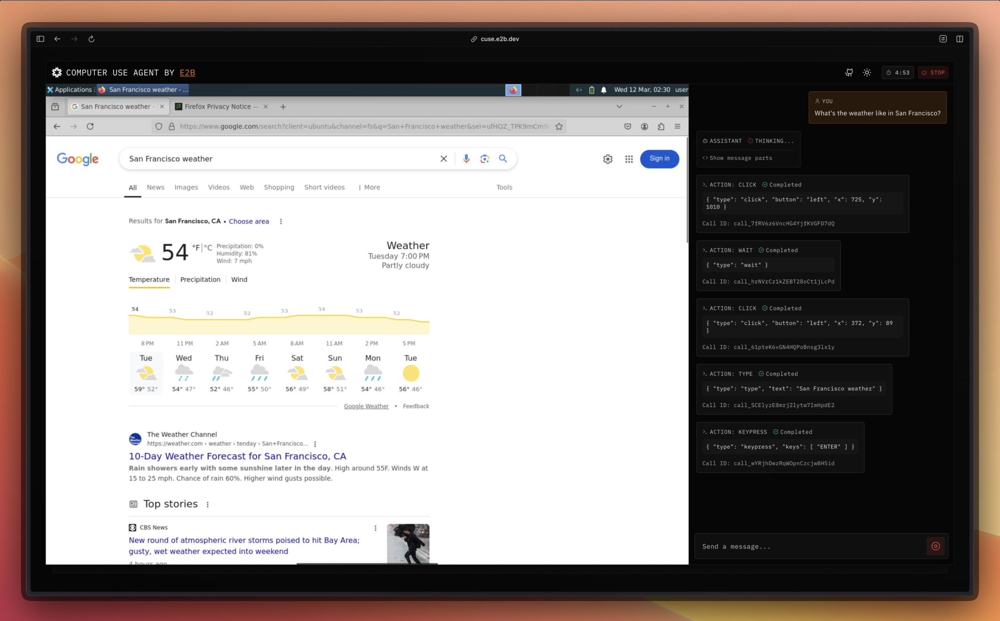
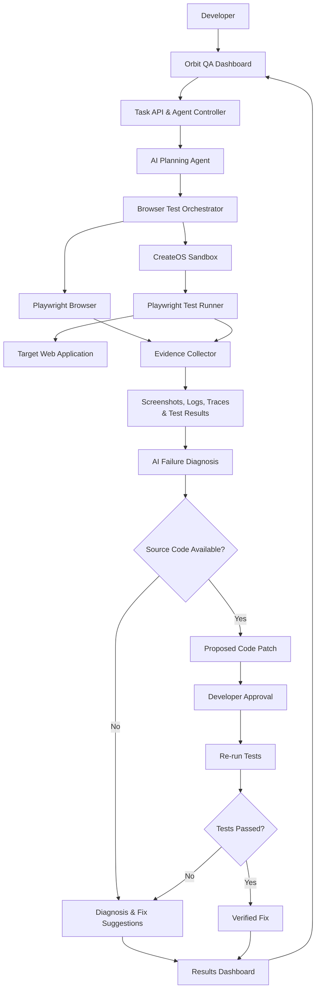

# Orbit QA: AI-powered self healing browser testing agent

**Find bugs. Reproduce them. Prove the fix.**

Orbit QA is an AI-powered browser testing agent that automatically tests web workflows, detects failures, generates reproducible Playwright tests, and helps developers diagnose and verify fixes using isolated CreateOS sandboxes.

Built for the **CreateOS Stripe Projects Hackathon**.

<p align="center">
  
</p>

---

## Overview

Manual testing is time-consuming, and traditional automated testing requires developers to write and maintain brittle test cases. **Orbit QA** simplifies this entire process by allowing developers to describe what they want to test in natural language.

The agent executes the workflow, identifies failures, reproduces them with Playwright, analyzes the evidence, and proposes fixes when source code is available.

---

## Key Features

- **AI-Powered Testing:** Test signup, login, onboarding, forms, and navigation using natural-language instructions.
- **Automated Bug Detection:** Identify failed assertions, browser console errors, and relevant network failures.
- **Bug Reproduction:** Generate and execute reproducible Playwright test cases.
- **AI-Assisted Diagnosis:** Analyze test results and suggest likely root causes.
- **Fix Suggestions:** Generate proposed code changes when the application's source code is accessible.
- **Automated Verification:** Re-run tests to determine whether a proposed fix works.
- **Isolated Execution:** Execute tests safely inside isolated CreateOS sandboxes.
- **Visual Evidence:** Collect screenshots, console logs, network traces, and test results.
- **Interactive Dashboard:** Monitor real-time browser activity, agent progress, errors, and outcomes.

---

## How It Works

1. **Input:** The developer enters a target website URL and testing instructions in natural language.
2. **Plan:** The AI agent formulates an autonomous testing plan.
3. **Execute:** Playwright executes the requested browser workflow.
4. **Detect:** Orbit QA identifies failures, runtime exceptions, and captures evidence.
5. **Reproduce:** The agent generates a standalone, reproducible Playwright test script.
6. **Diagnose:** The AI analyzes collected evidence and pinpoints the probable root cause.
7. **Patch:** If source code is available, the agent proposes a code fix.
8. **Verify:** The test re-executes inside the sandbox to prove whether the fix works.
9. **Report:** The dashboard presents the verdict with full visual and diagnostic logs.

---

## Architecture



---

## Technology Stack

| Technology | Purpose |
|---|---|
| **Turborepo** | High-performance monorepo build system (`apps/web`, `apps/docs`, `packages/*`) |
| **Next.js & React** | Interactive full-stack web dashboard |
| **TypeScript** | Strict, end-to-end type safety |
| **AI Models (AI SDK)** | Test planning, failure diagnosis, and patch generation |
| **Playwright** | Browser automation, user interaction, and test execution |
| **CreateOS Sandbox SDK** | Isolated, secure execution environment for tests |
| **Node.js** | Backend orchestration and task execution |
| **Stripe Projects** | Hackathon project setup and service integration |

---

## User Interface

Orbit QA features a clean, responsive two-panel layout:

* **Left Panel - Browser Workspace:**
  - Target website live preview and browser view.
  - Active URL and real-time execution status.
  - Captured screenshots and visual timeline.

* **Right Panel - Agent Workspace:**
  - Natural-language prompt and task input.
  - Live execution step timeline and progress indicator.
  - Generated Playwright test code viewer.
  - Console logs, network traces, and error details.
  - Root cause analysis, code diffs, and verification controls.

---

## CreateOS Configuration

Set up your CreateOS sandbox credentials in your environment variables:

```env
CREATEOS_SANDBOX_BASE_URL=https://api-eu.sb.createos.sh/
CREATEOS_SANDBOX_API_KEY=your_api_key_here
GEMINI_API_KEY=your_gemini_api_key_here
STRIPE_SECRET_KEY=your_stripe_secret_key_here
NEXT_PUBLIC_STRIPE_PUBLISHABLE_KEY=your_stripe_publishable_key_here
```

---

## Getting Started

### 1. Prerequisites
Ensure you have Node.js 18+ and `pnpm` installed:
```bash
npm install -g pnpm
```

### 2. Install Dependencies
```bash
pnpm install
```

### 3. Environment Setup
Copy the example environment file and configure your keys:
```bash
cp apps/web/.env.example apps/web/.env.local
```

### 4. Run Development Server
Start the Turborepo development workspace:
```bash
pnpm dev
# or
npx turbo run dev
```

* **Web Application:** [http://localhost:3000](http://localhost:3000)


